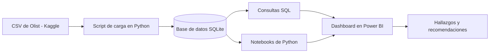

# 🛒 Análisis de Ventas y Clientes de un E-commerce (Olist)

> Proyecto de análisis de datos con **SQL, Python y Power BI** sobre más de 99 mil pedidos reales de un marketplace brasileño.

**Estado del proyecto:** 🚧 En desarrollo

---

## 📑 Tabla de contenidos

1. [Descripción general](#1-descripción-general)
2. [Problema de negocio](#2-problema-de-negocio)
3. [Objetivos](#3-objetivos)
4. [Preguntas de negocio](#4-preguntas-de-negocio)
5. [Conjunto de datos](#5-conjunto-de-datos)
6. [Stack tecnológico](#6-stack-tecnológico)
7. [Arquitectura y flujo de trabajo](#7-arquitectura-y-flujo-de-trabajo)
8. [Estructura del repositorio](#8-estructura-del-repositorio)
9. [Calidad de los datos](#9-calidad-de-los-datos)
10. [Resultados y hallazgos](#10-resultados-y-hallazgos)
11. [Dashboard](#11-dashboard)
12. [Cómo reproducir el proyecto](#12-cómo-reproducir-el-proyecto)
13. [Próximos pasos](#13-próximos-pasos)
14. [Autor](#14-autor)

---

## 1. Descripción general

Este proyecto analiza las ventas y el comportamiento de los clientes de **Olist**, un marketplace de Brasil, a partir de un conjunto de datos público con pedidos realizados entre 2016 y 2018. El trabajo cubre el ciclo completo de un análisis de datos: carga y organización de los datos, exploración y control de calidad, análisis con SQL y Python, y visualización en un dashboard de Power BI.

## 2. Problema de negocio

Un e-commerce necesita entender **cómo evolucionan sus ventas, qué productos generan más ingresos y cómo se comportan sus clientes** para tomar mejores decisiones comerciales (inventario, campañas, retención). Este proyecto simula el rol de un analista de datos que debe responder esas preguntas con evidencia.

## 3. Objetivos

- Evaluar la **calidad de los datos** y definir criterios claros para el análisis.
- Medir la **evolución de las ventas** y detectar tendencias, picos y estacionalidad.
- Identificar las **categorías de productos** que más aportan a los ingresos.
- Analizar el **comportamiento de los clientes**: recompra y segmentación (RFM).
- Evaluar el **desempeño logístico** y su relación con la satisfacción del cliente.
- Comunicar los hallazgos en un **dashboard** y recomendaciones accionables.

## 4. Preguntas de negocio

- [x] ¿Cómo evolucionan las ventas y los pedidos mes a mes?
- [x] ¿Qué categorías de productos generan más ingresos?
- [x] ¿Cuál es el ticket promedio y cómo ha cambiado?
- [x] ¿Cuál es la tasa de recompra y quiénes son los mejores clientes (RFM)?
- [ ] ¿Cuánto tardan las entregas y cómo afectan la calificación del cliente?

## 5. Conjunto de datos

**Fuente:** [Brazilian E-Commerce Public Dataset by Olist](https://www.kaggle.com/datasets/olistbr/brazilian-ecommerce) (Kaggle). Consulta la licencia de uso en la página del dataset. Los archivos originales **no se incluyen** en este repositorio.

| Tabla | Descripción |
|---|---|
| `orders` | Un registro por pedido: estado y fechas de compra, aprobación y entrega |
| `customers` | Datos del cliente y su ubicación (`customer_unique_id` identifica a la persona real) |
| `order_items` | Productos de cada pedido, con precio y flete |
| `order_payments` | Forma y monto de pago |
| `order_reviews` | Calificaciones y comentarios de los clientes |
| `products` | Características y categoría de cada producto |
| `product_category_name_translation` | Traducción de las categorías de portugués a inglés |
| `sellers` | Vendedores |
| `geolocation` | Coordenadas por código postal |

**Volumen:** 99,441 pedidos entre el 04/09/2016 y el 17/10/2018.

## 6. Stack tecnológico

| Herramienta | Uso en el proyecto |
|---|---|
| **Python** (pandas, matplotlib, seaborn) | Carga de datos, análisis y visualización |
| **SQLite** | Base de datos local para las consultas |
| **SQL** | Exploración, calidad de datos y análisis (JOINs, CTEs, funciones de ventana) |
| **DB Browser for SQLite** | Ejecución y prueba de consultas |
| **Power BI Desktop** | Dashboard interactivo |
| **Jupyter + VS Code** | Entorno de desarrollo |
| **Git y GitHub** | Control de versiones y publicación |

## 7. Arquitectura y flujo de trabajo



## 8. Estructura del repositorio

```
olist-ecommerce-analysis/
├── data/              # CSV originales (no versionados)
├── scripts/
│   └── load_data.py   # Carga los CSV a SQLite
├── sql/
│   ├── 01_exploracion.sql
│   ├── 02_ventas.sql
│   ├── 03_variacion_mensual.sql
│   ├── 04_categorias.sql
│   ├── 05_ticket_promedio.sql
│   ├── 06_recompra.sql
│   └── 07_rfm.sql

├── notebooks/         # Análisis y gráficos en Python
├── dashboard/         # Archivo de Power BI
├── docs/images/       # Capturas para este README
├── requirements.txt
├── .gitignore
└── README.md
```

## 9. Calidad de los datos

Antes de analizar, se revisó la consistencia de los datos con consultas SQL (`sql/01_exploracion.sql`).

| Aspecto | Hallazgo | Decisión |
|---|---|---|
| Estado de los pedidos | De 99,441 pedidos, cerca de 96 mil están `delivered` y unos 1,000 `shipped`; el resto son cancelados, no disponibles u otros estados | Las ventas reales se miden solo con pedidos `delivered` |
| Periodo | 04/09/2016 al 17/10/2018 | — |
| Meses incompletos | No hay pedidos en noviembre de 2016; septiembre y diciembre de 2016 y septiembre y octubre de 2018 tienen muy poca actividad | Ventana de análisis: **enero 2017 a agosto 2018** |
| Valores nulos | 160 pedidos sin fecha de aprobación y 2,965 sin fecha de entrega (no entregados o aún en curso) | Pendiente revisar pedidos `delivered` sin fecha de entrega |
| Identificación de clientes | 99,441 `customer_id` frente a 96,096 `customer_unique_id`: cada pedido genera un `customer_id` nuevo | Usar `customer_unique_id` para recompra y RFM |
| Pedidos sin productos | 775 pedidos (menos del 1 %): 603 `unavailable`, 164 `canceled`, 5 `created`, 2 `invoiced` y 1 `shipped` (inconsistencia) | No generan ingresos; se excluyen al unir con `order_items` y filtrar por `delivered` |

## 10. Resultados y hallazgos

**Definición de venta:** suma del precio de los productos (`price` en `order_items`) de pedidos `delivered`, sin incluir el flete.

### 10.1 Evolución de las ventas

- Crecimiento sostenido durante 2017: de **~112 mil** en enero a **~988 mil** en noviembre.
- **Noviembre de 2017 es el pico del periodo** (+52.4 % frente a octubre), en línea con la temporada de Black Friday. Es también el mayor aumento en monto (unos 340 mil más que octubre).
- **Diciembre de 2017 baja 26.5 %**, una caída estacional posterior al pico: aun así supera las ventas de octubre.
- En **2018 las ventas se estabilizan en una meseta alta** (entre ~826 mil y ~978 mil mensuales). Mayo de 2018 es el segundo mes con más ventas del periodo.
- El primer descenso claro de 2018 aparece en **junio (−12.4 %)**, y luego las ventas se mantienen alrededor de 840 a 870 mil.

Consultas: [`sql/02_ventas.sql`](sql/02_ventas.sql) (ventas mensuales) y
[`sql/03_variacion_mensual.sql`](sql/03_variacion_mensual.sql) (variación frente al mes anterior).

### 10.2 Categorías más vendidas

Análisis de pedidos `delivered` entre enero de 2017 y agosto de 2018.

| Categoría | Unidades | Ventas (R$) | % del total |
|---|---|---|---|
| health_beauty | 9,422 | 1,229,558 | 9.3 % |
| watches_gifts | 5,855 | 1,163,466 | 8.8 % |
| bed_bath_table | 10,945 | 1,022,956 | 7.8 % |
| sports_leisure | 8,414 | 952,840 | 7.2 % |
| computers_accessories | 7,632 | 888,056 | 6.7 % |
| furniture_decor | 8,095 | 706,237 | 5.4 % |
| housewares | 6,783 | 614,342 | 4.7 % |
| cool_stuff | 3,711 | 609,158 | 4.6 % |
| auto | 4,132 | 577,838 | 4.4 % |
| garden_tools | 4,263 | 469,135 | 3.6 % |

- **Ingresos diversificados:** ninguna categoría supera el 10 %; las 5 primeras
  concentran ~39.8 % de las ventas y las 10 primeras ~62.5 %.
- **Volumen vs. valor:** `bed_bath_table` lidera en unidades pero es 3.ª en
  ventas por su precio promedio bajo (~R$ 93), mientras que `watches_gifts`
  es 2.ª en ventas con menos unidades gracias a su precio alto (~R$ 199).
- **Categorías de bajo ticket:** `furniture_decor` y `telephony` (~R$ 70)
  aportan menos ingresos de lo que sugiere su volumen.

Consulta: [`sql/04_categorias.sql`](sql/04_categorias.sql)

### 10.3 Ticket promedio

El **ticket promedio** es el gasto por pedido (ventas ÷ pedidos entregados).

- Se mueve entre ~R$ 124 (julio de 2017) y ~R$ 149 (enero de 2017), sin una
  tendencia clara. En el periodo completo ronda los R$ [valor de tu consulta global].
- Cada pedido contiene en promedio apenas ~1.1 productos (entre 1.11 y 1.16 en casi
  todos los meses): la gran mayoría de los pedidos son de un solo producto.
- El crecimiento de las ventas se explica por **más pedidos, no por pedidos más
  grandes**: en noviembre de 2017 los pedidos subieron ~63 % frente a octubre,
  mientras el ticket bajó ~6 % (de R$ 144.8 a R$ 135.5).
- **Oportunidad (hipótesis a evaluar):** al ser pedidos casi siempre de un solo
  producto, hay espacio para estrategias de venta cruzada o paquetes de productos.

Consulta: [`sql/05_ticket_promedio.sql`](sql/05_ticket_promedio.sql)

### 10.4 Clientes y recompra

La recompra se mide con `customer_unique_id` (la persona real), sobre pedidos
`delivered` entre enero de 2017 y agosto de 2018.

| Pedidos por cliente | Clientes | % |
|---|---|---|
| 1 | 90,315 | 97.0 % |
| 2 | 2,562 | 2.8 % |
| 3 | 180 | 0.2 % |
| 4 o más | 47 | < 0.1 % |

- De **93,104 clientes**, solo **2,789 (3.0 %)** compraron más de una vez.
- Entre los clientes recurrentes, el 92 % compró exactamente dos veces.
- Un cliente llegó a 15 pedidos y otro a 9; podrían ser revendedores o compradores
  empresariales (hipótesis a validar).
- **Implicación:** el crecimiento depende de captar clientes nuevos; la retención es
  la principal oportunidad de mejora.
- **Limitación:** los clientes que compraron cerca del final del periodo tuvieron
  menos tiempo para volver, por lo que la tasa podría estar levemente subestimada.

Consulta: [`sql/06_recompra.sql`](sql/06_recompra.sql)

### 10.5 Segmentación de clientes (RFM adaptado)

Se segmentó a los 93,104 clientes según **recencia** (días desde su última compra
hasta el 01/09/2018) y **monto** gastado, puntuados del 1 al 5 con `NTILE(5)`.
Como el 97 % de los clientes compró una sola vez, la **frecuencia** no sirve para
diferenciarlos y se usó solo para identificar a los recurrentes.

Las reglas se evalúan en este orden: Campeones (R ≥ 4 y M ≥ 4), Recurrentes
(2 o más pedidos), Alto valor con una compra (M ≥ 4), Nuevos recientes (R ≥ 4),
Inactivos de bajo valor (R ≤ 2 y M ≤ 2) y Ocasionales (el resto).

| Segmento | Clientes | % ventas | Gasto promedio | Recencia promedio |
|---|---|---|---|---|
| Alto valor, una compra | 20,677 | 42.0 % | R$ 267 | 335 días |
| Campeones | 15,365 | 31.6 % | R$ 271 | 93 días |
| Ocasionales | 18,391 | 9.6 % | R$ 69 | 289 días |
| Nuevos recientes | 21,606 | 9.1 % | R$ 56 | 91 días |
| Inactivos de bajo valor | 15,202 | 4.6 % | R$ 40 | 395 días |
| Recurrentes | 1,863 | 3.2 % | R$ 226 | 286 días |

- Alto valor y Campeones (39 % de los clientes) generan el **73.6 % de las ventas**.
- **Alto valor, una compra** es el segmento de mayor oportunidad: gastó mucho pero
  lleva casi un año sin volver (campañas de reactivación).
- **Nuevos recientes** es el grupo más numeroso pero de bajo gasto: el objetivo
  sería impulsar una segunda compra.
- Nota: "Recurrentes" excluye a 926 clientes recurrentes clasificados como
  Campeones, porque esa regla se evalúa primero.
- Las acciones propuestas son hipótesis a validar, no resultados.

Consulta: [`sql/07_rfm.sql`](sql/07_rfm.sql)

### 10.6 Logística y satisfacción

🚧 Pendiente.

## 11. Dashboard

🚧 Pendiente. Aquí se incluirá una captura del dashboard de Power BI.

<!--  -->

## 12. Cómo reproducir el proyecto

1. Clona el repositorio:
   ```bash
   git clone https://github.com/JuanAleivaLeiva/olist-ecommerce-analysis.git
   cd olist-ecommerce-analysis
   ```
2. Crea y activa un entorno virtual e instala las dependencias (PowerShell):
   ```powershell
   python -m venv .venv
   .venv\Scripts\Activate.ps1
   pip install -r requirements.txt
   ```
3. Descarga los CSV desde Kaggle y colócalos en la carpeta `data/`.
4. Crea la base de datos:
   ```powershell
   python scripts/load_data.py
   ```
5. Abre `olist.db` con DB Browser for SQLite y ejecuta las consultas de la carpeta `sql/`.

## 13. Próximos pasos

- [x] Categorías más vendidas y concentración de ingresos
- [x] Ticket promedio y su evolución
- [x] Tasa de recompra y segmentación RFM
- [ ] Análisis de tiempos de entrega y calificaciones
- [ ] Análisis en Python con gráficos (notebooks)
- [ ] Dashboard en Power BI
- [ ] Conclusiones y recomendaciones de negocio

## 14. Autor

**[Juan Alexis Leiva Leiva]** · Aspirante a Analista de Datos e Ingeniero de Datos
[LinkedIn](https://www.linkedin.com/in/leiva-leiva-juan-alexis/) · [GitHub](https://github.com/JuanALeivaLeiva) · [Correo](leivaleivaja26@gmail.com)

